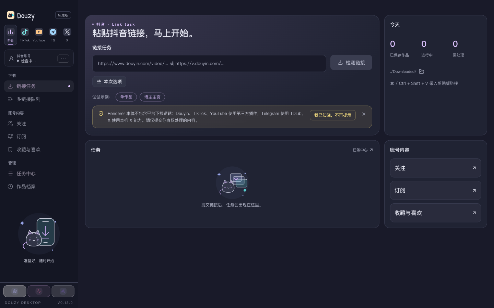
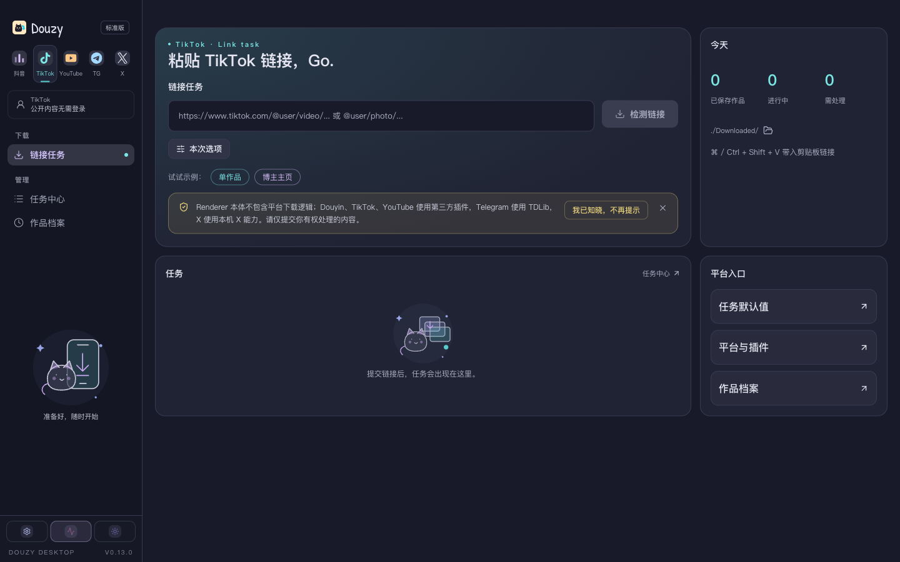
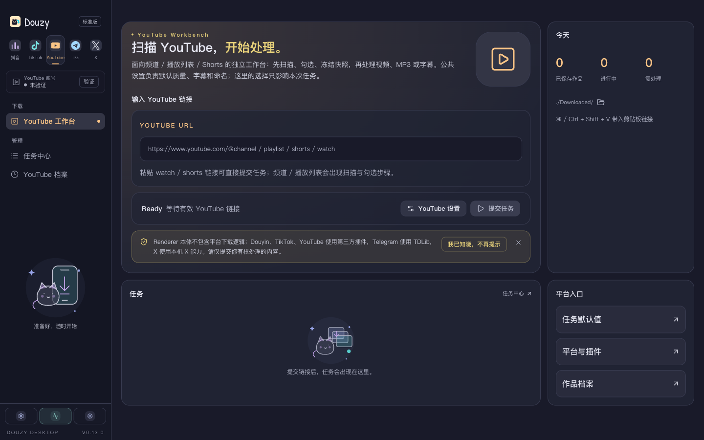
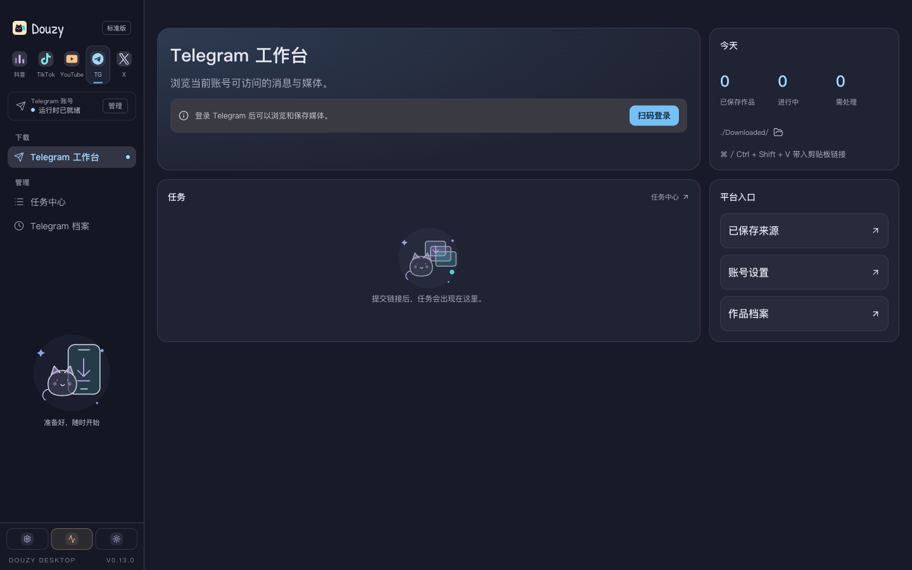
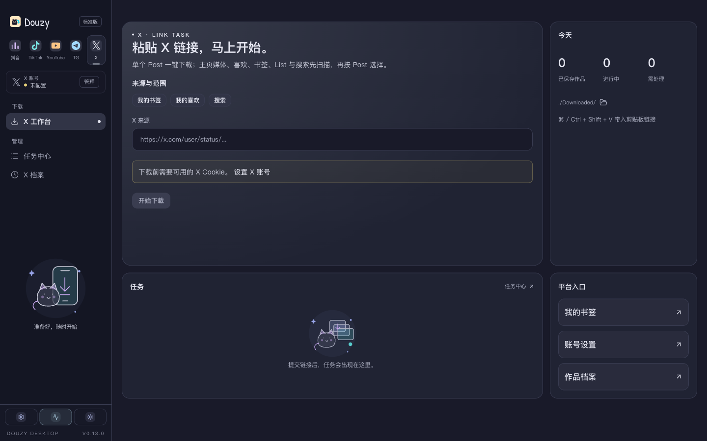
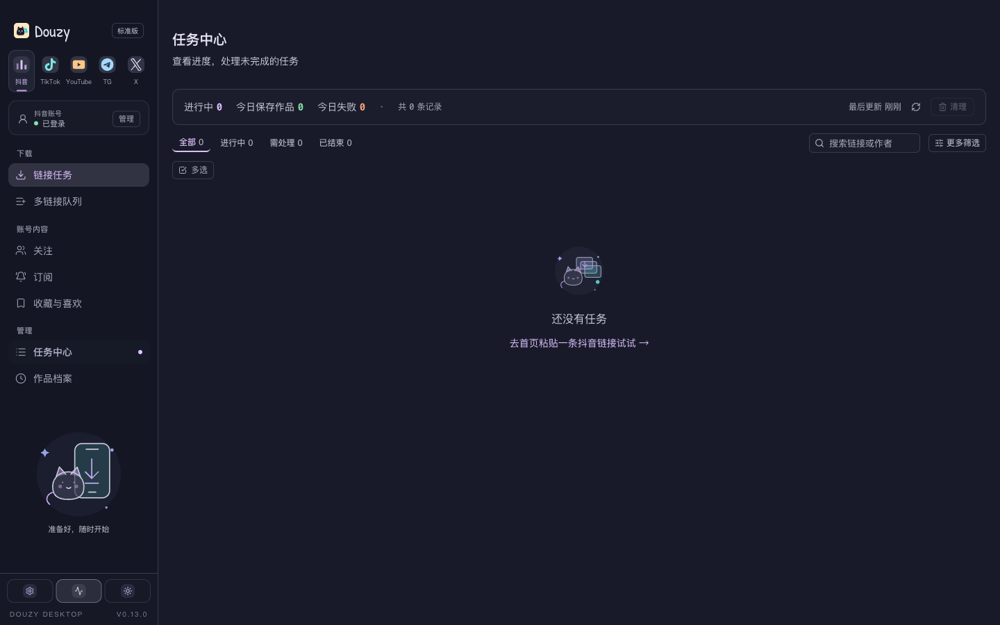
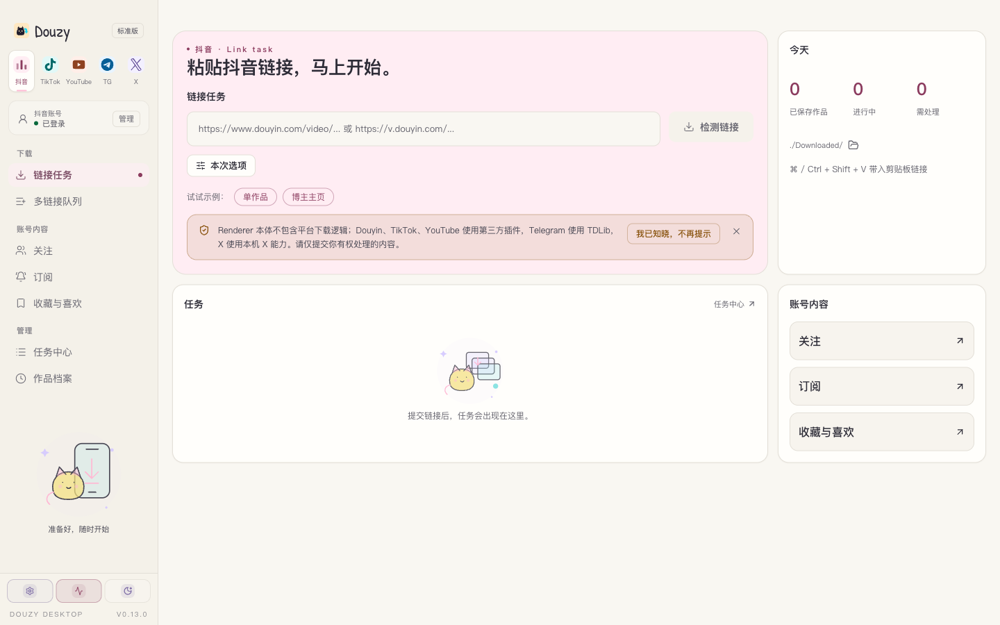
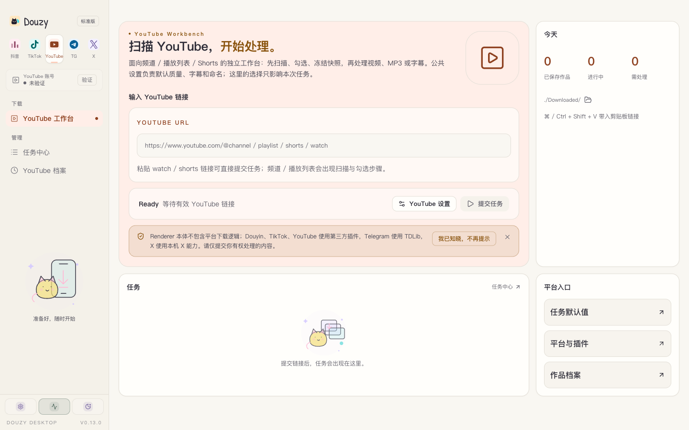
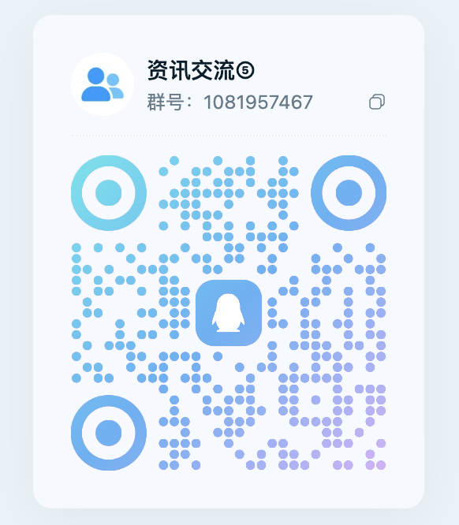

<!-- README.md is also the PyPI project page: keep links and images absolute. -->
# Douyin Downloader

<p align="center">
  
</p>

[简体中文](https://github.com/jiji262/douyin-downloader/blob/main/README.zh-CN.md) · **English**

Download Douyin videos and photos without watermarks. Use **Douzy** for a desktop interface, the **Python CLI** for scripts, or the **[agent skill](#agent--skill-mode)** so AI agents such as Claude Code and Codex can read the hot board, search, and record live streams.

## Douzy Desktop

A desktop app for **Douyin, TikTok, YouTube, Telegram, and X**. Paste links, track downloads, and browse your local archive.

**[Download for Windows / macOS](https://github.com/jiji262/douyin-downloader/releases)**

Platform features depend on enabled plugins or local components. Some batch and advanced features require activation.

| Platform | Content |
|:---|:---|
| Douyin | Videos, photos, profiles, collections; following, subscriptions, favorites, and likes |
| TikTok | Public videos, photos, and profiles |
| YouTube | Videos, Shorts, channels, and playlists; audio and subtitles |
| Telegram | Media from accessible chats, groups, and channels; requires setup and sign-in |
| X | Posts, profile media, your bookmarks and likes; requires account cookies |

| **Douyin** | **TikTok** | **YouTube** |
|:---:|:---:|:---:|
| [](https://github.com/jiji262/douyin-downloader/blob/main/img/desktop/001.png) | [](https://github.com/jiji262/douyin-downloader/blob/main/img/desktop/002.png) | [](https://github.com/jiji262/douyin-downloader/blob/main/img/desktop/003.png) |
| **Telegram setup** | **X** | **Task center** |
| [](https://github.com/jiji262/douyin-downloader/blob/main/img/desktop/004.png) | [](https://github.com/jiji262/douyin-downloader/blob/main/img/desktop/005.png) | [](https://github.com/jiji262/douyin-downloader/blob/main/img/desktop/006.png) |

| **Douyin (light)** | **YouTube (light)** | **Task center (light)** |
|:---:|:---:|:---:|
| [](https://github.com/jiji262/douyin-downloader/blob/main/img/desktop/007.png) | [](https://github.com/jiji262/douyin-downloader/blob/main/img/desktop/008.png) | [](https://github.com/jiji262/douyin-downloader/blob/main/img/desktop/009.png) |

_Screenshots: Douzy 0.13.0 on macOS (light and dark themes, 1440 × 900, sample data). Telegram is shown before setup. Click an image to enlarge._

## CLI Status

The CLI supports **Douyin only**. It includes batch downloads, date filters, retries, download history, and optional comments, transcription, and notifications.

> **Download limitations:** Douyin's request verification currently blocks CLI downloads of individual videos/photos, collections, music, likes, and favorites. Profile posts can try the Playwright browser fallback, but success is not guaranteed. Use **Douzy** for everyday downloads.

Refreshing cookies or retrying does not fix this verification block. Live recording is experimental: FFmpeg records the stream in segments, converts each segment to MP4, and reconnects after drops.

## Quick Start

Requires **Python 3.10+** on Windows, macOS, or Linux. Read the CLI limitations above first.

### 1. Install

```bash
git clone https://github.com/jiji262/douyin-downloader.git
cd douyin-downloader
python -m pip install -r requirements.txt
python -m pip install playwright
python -m playwright install chromium
```

### 2. Configure and sign in

Copy [config.example.yml](https://github.com/jiji262/douyin-downloader/blob/main/config.example.yml) to `config.yml`:

```bash
cp config.example.yml config.yml
python -m tools.cookie_fetcher --config config.yml
```

On Windows PowerShell, use `Copy-Item config.example.yml config.yml` to copy the file. Sign in to Douyin in the browser, then return to the terminal and press Enter to save cookies.

Replace the sample `link` in `config.yml` with your creator's profile URL. Keep the saved cookies and adjust these fields:

```yaml
link:
  - https://www.douyin.com/user/YOUR_SEC_UID
path: ./Downloaded/
mode: [post]
number:
  post: 10                 # 0 = unlimited
increase:
  post: true              # skip downloaded items
redownload_missing_files: true
```

### 3. Run

```bash
python run.py -c config.yml
```

Use `python run.py --help` for all options.

| Option | Purpose |
|:---|:---|
| `-c, --config` | Config file |
| `-u, --url` | Append a URL to the links in the config; repeatable |
| `-p, --path` | Download folder |
| `-t, --thread` | Concurrent downloads |
| `-v, --verbose` | Detailed logs |

| Exit code | Meaning |
|:---|:---|
| `0` | Finished. Some items may still have failed; check the summary |
| `1` | Nothing was downloaded or skipped and at least one item failed, or a fatal error occurred |
| `3` | The sign-in expired and could not be renewed; the other URLs in the batch were still processed |

## Configuration

Full settings and examples: **[config.example.yml](https://github.com/jiji262/douyin-downloader/blob/main/config.example.yml)**.

| Setting | Purpose |
|:---|:---|
| `number.post` | Item limit; `0` means unlimited |
| `start_time` / `end_time` | Date range (`YYYY-MM-DD`); includes the whole end date |
| `video_quality` | `highest` by default; `original` tries the original upload and falls back |
| `increase.post` | `true` skips downloaded items; `false` downloads again and overwrites files in the selected scope |
| `redownload_missing_files` | Default `true`: download missing files again. With `false`, valid database history can still skip them |

Incremental downloads check for non-empty primary media on disk. You do **not** need to clear the database to download again: set `increase.post: false`. The same switch is available for `like`, `mix`, and `music`.

<details>
<summary>More CLI commands</summary>

```bash
# Hot search board and keyword search → JSONL
python run.py --hot-board 30
python run.py --search "cats" --search-max 50

# Optional REST API server
python -m pip install fastapi uvicorn
python run.py --serve --serve-port 8000
```

Comments, transcription, notifications, and live recording are configured in [config.example.yml](https://github.com/jiji262/douyin-downloader/blob/main/config.example.yml).

</details>

## Agent / Skill Mode

`douyin-dl agent <verb>` is a machine-readable mode for AI agents. Each run prints exactly one JSON line on stdout (logs go to stderr), with stable error and exit codes. The bundled skill `skills/douyin-dl/` teaches an agent when and how to call it.

**1. Install the CLI**

```bash
uv tool install douyin-dl        # or: pipx install douyin-dl
# unreleased code from GitHub: uv tool install git+https://github.com/jiji262/douyin-downloader
douyin-dl agent doctor
```

In a cloned checkout with the requirements installed, `python run.py agent doctor` works too. Do not `pip install` the package into a shared environment: its top-level packages `utils`, `core`, and `config` collide with other projects.

**2. Install the skill** (pick one)

```bash
# Claude Code
/plugin marketplace add jiji262/douyin-downloader
/plugin install douyin-dl@douyin-dl

# Codex and other agents: copy the folder
cp -r skills/douyin-dl ~/.agents/skills/

# or use the skills CLI
npx skills add jiji262/douyin-downloader
```

**3. Try it**

```bash
douyin-dl agent hot --max 3
# {"schema":1,"ok":true,"verb":"hot","version":"2.1.0","data":{"items":[…],"count":3},"error":null,"warnings":[]}
```

| Status | Capabilities |
|:---|:---|
| Available | Hot search board (`hot`), link classification (`inspect`), live recording (`live`), local transcription (`transcribe`), environment check (`doctor`) |
| Sign-in required | Keyword search (`search`), profile info (`user`); sign in with `douyin-dl agent login` in your own browser window |
| Blocked | Downloading videos/photos, collections, music, or a profile's posts by link returns `ARGUS_GATED`. Use **Douzy** |

Exit codes: `0` success · `1` internal error · `2` bad arguments or unsupported link · `3` sign-in required · `4` `ARGUS_GATED` · `5` upstream returned nothing (rate limit, anti-bot, or the room is not live) · `6` partial result · `7` missing dependency · `130` interrupted.

- Agent mode keeps its own sign-in in `~/.douyin-dl` (set `DOUYIN_DL_HOME` to move it). It does not read `config.yml` or the cookies saved by `tools.cookie_fetcher`, and cookie values never appear in its output.
- `login` needs Playwright and Chromium; `transcribe` needs Whisper. `doctor` lists what is missing with the exact install command.
- Set `DOUYIN_PROXY` to send requests through a proxy.

Details: [contract](https://github.com/jiji262/douyin-downloader/blob/main/skills/douyin-dl/references/contract.md) · [troubleshooting](https://github.com/jiji262/douyin-downloader/blob/main/skills/douyin-dl/references/troubleshooting.md)

## FAQ

**Cookies expired?** Run `python -m tools.cookie_fetcher --config config.yml` again.

**Only a few profile posts?** Keep `browser_fallback.enabled: true` and `headless: false`. Complete any verification yourself in the browser; the current verification block may still prevent downloads.

**Need logs?** Run `python run.py -c config.yml -v`.

## Development

```bash
python -m pip install -e ".[dev]"
python -m pytest tests/
ruff check .
```

## Community & License

[QQ group](https://qm.qq.com/q/8wrCzYyLHa) · [LINUX DO](https://linux.do/) · [MIT License](https://github.com/jiji262/douyin-downloader/blob/main/LICENSE)



For learning and personal data management. Respect copyright, privacy, and platform rules. You are responsible for how you use this tool; platform changes may affect availability.

## Star History

[View GitHub Star History](https://www.star-history.com/?repos=jiji262%2Fdouyin-downloader&type=date&legend=top-left)
