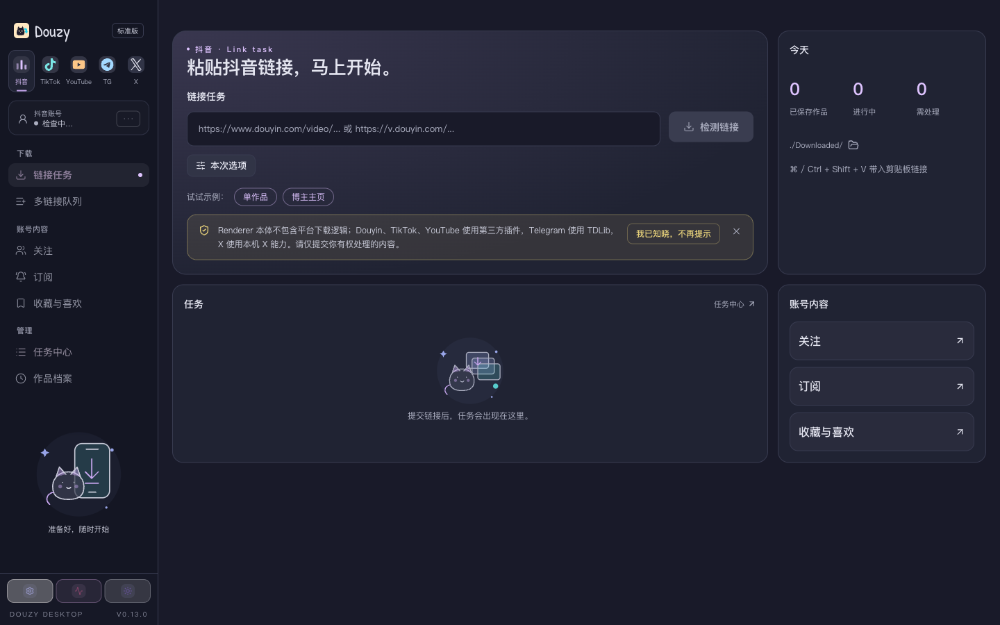
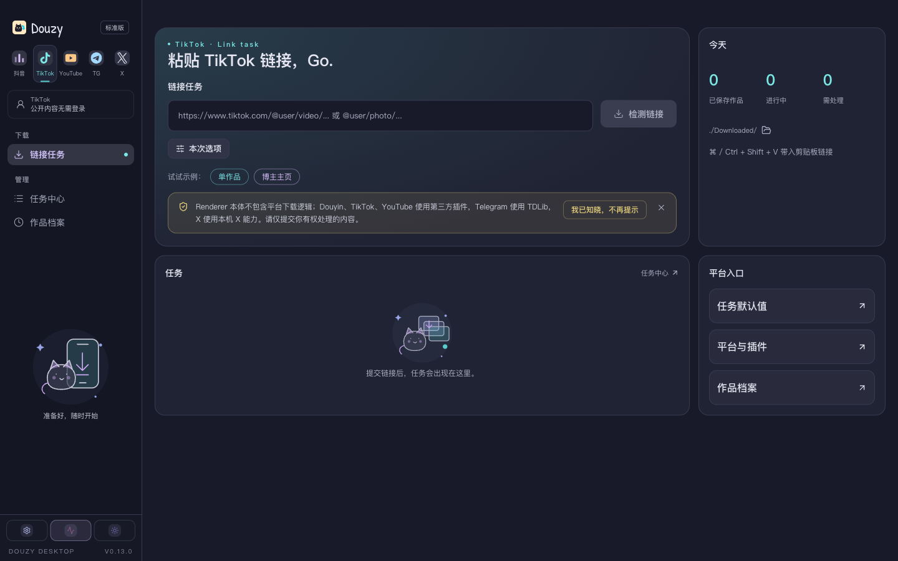
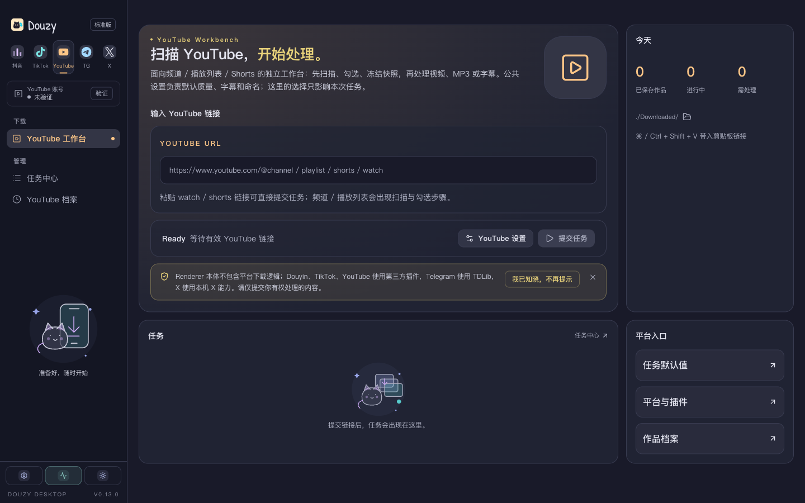
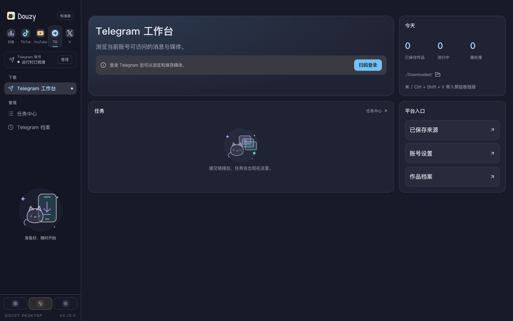
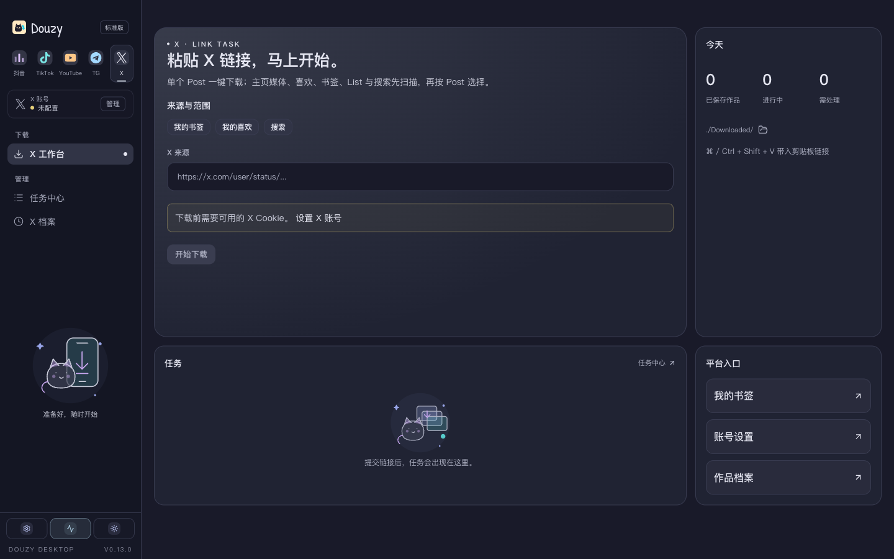
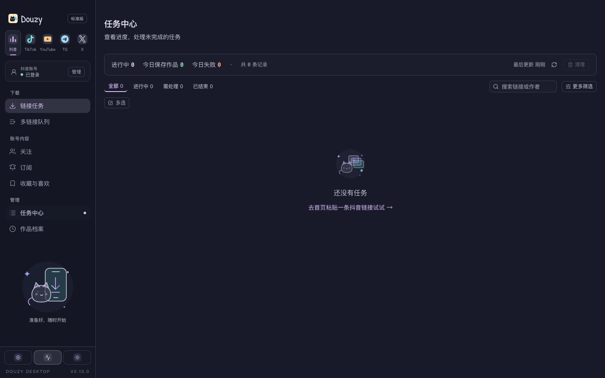
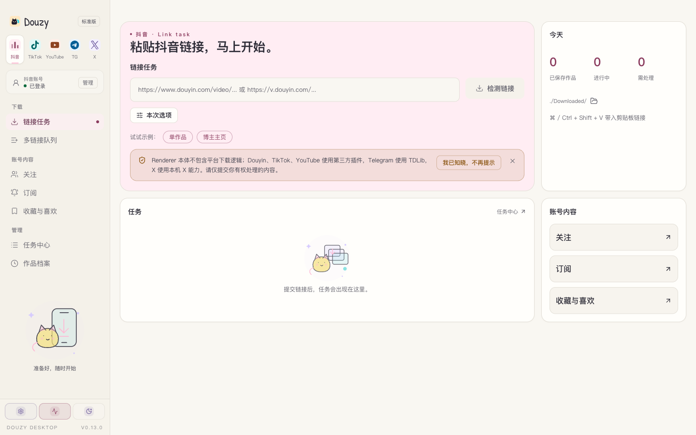
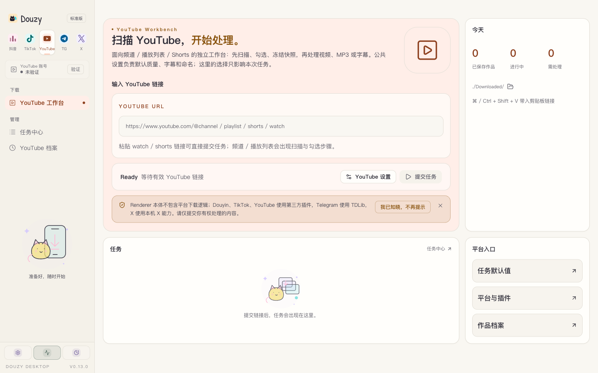
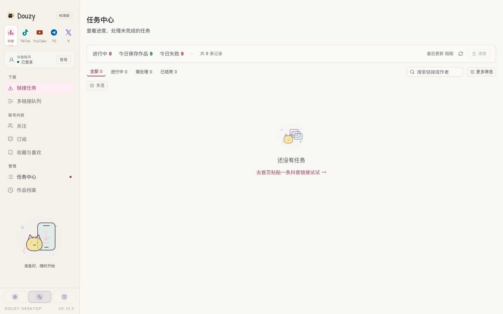
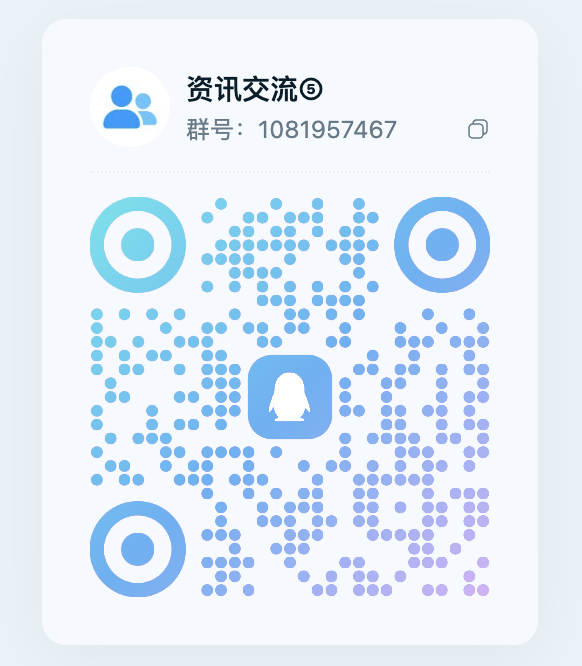

# 抖音下载器（Douyin Downloader）

<p align="center">
  
</p>

**简体中文** · [English](README.md)

**面向 AI Agent 的抖音 Skill。** 让 Claude Code、Codex 等 agent 查热榜、搜索、看博主资料、录直播、转写媒体。每条 `douyin-dl agent` 命令只输出一行 JSON，错误码固定；仓库自带的 [skill](#ai-agent--skill-用法) 告诉 agent 何时、如何调用。想下载无水印视频和图文，请用 **[Douzy 桌面版](#douzy-桌面版)**。

## AI Agent / Skill 用法

**1. 安装 CLI**

```bash
uv tool install douyin-dl-cli    # 或：pipx install douyin-dl-cli
# GitHub 上尚未发布的代码：uv tool install git+https://github.com/jiji262/douyin-downloader
douyin-dl agent doctor
```

PyPI 包名是 `douyin-dl-cli`，装好后的命令是 `douyin-dl`。已克隆仓库并装好依赖时，也可以直接运行 `python run.py agent doctor`。不要用 `pip install` 装进共享环境：顶层包名 `utils`、`core`、`config` 会与其他项目冲突。

**2. 安装 skill**（任选一种）

```bash
# Claude Code
/plugin marketplace add jiji262/douyin-downloader
/plugin install douyin-dl@douyin-dl

# Codex 及其他 agent：复制目录（在本仓库克隆目录下执行）
cp -r skills/douyin-dl ~/.agents/skills/

# 或使用 skills CLI
npx skills add jiji262/douyin-downloader
```

**3. 对 agent 说**

- 「抖音热榜现在有什么？」
- 「在抖音搜索 `猫咪`，总结前 10 条结果。」
- 「看一下这个博主的资料：`https://www.douyin.com/user/…`」
- 「录制这个直播间 5 分钟：`https://live.douyin.com/…`」
- 「转写本地的 `./clip.mp4`。」

agent 实际执行的是 `douyin-dl agent hot --max 3` 这类命令，并读取它输出的那一行 JSON：

```bash
douyin-dl agent hot --max 3
# {"schema":1,"ok":true,"verb":"hot","version":"2.1.0","data":{"items":[…],"count":3},"error":null,"warnings":[]}
```

| 状态 | 能力 |
|:---|:---|
| 可用 | 热搜榜（`hot`）、链接识别（`inspect`）、直播录制（`live`）、本地转写（`transcribe`）、环境检查（`doctor`） |
| 需登录 | 关键词搜索（`search`）、主页信息（`user`）；运行 `douyin-dl agent login`，在自己的浏览器窗口中登录 |
| 受限 | 按链接下载视频／图文、合集、音乐或主页作品会返回 `ARGUS_GATED`，请使用 **Douzy** |

- agent 模式的登录态单独保存在 `~/.douyin-dl`（可用 `DOUYIN_DL_HOME` 改位置），不读取 `config.yml` 或 `tools.cookie_fetcher` 保存的 Cookie，输出中也不会出现 Cookie 值。
- `login` 需要 Playwright 和 Chromium，`transcribe` 需要 Whisper。`doctor` 会列出缺少的组件和确切的安装命令。
- 需要代理时设置 `DOUYIN_PROXY`。

固定的错误码与退出码、逐字段说明：[契约](skills/douyin-dl/references/contract.md) · [故障排查](skills/douyin-dl/references/troubleshooting.md)

## Douzy 桌面版

用来下载抖音无水印视频和图文，支持 **抖音、TikTok、YouTube、Telegram、X**。粘贴链接下载，查看任务进度，管理本地作品档案。

**[下载 Windows / macOS 版](https://github.com/jiji262/douyin-downloader/releases)**

平台功能由已启用的插件或本机组件提供，部分批量与高级功能需要激活。

| 平台 | 内容 |
|:---|:---|
| 抖音 | 视频、图文、主页、合集；关注、订阅、收藏与喜欢 |
| TikTok | 公开视频、图集与主页 |
| YouTube | 视频、Shorts、频道、播放列表；音频与字幕 |
| Telegram | 有权访问的聊天、群组与频道媒体；需配置并登录 |
| X | 帖子、主页媒体、自己的书签与喜欢；需配置账号 Cookie |

| **抖音** | **TikTok** | **YouTube** |
|:---:|:---:|:---:|
| [](img/desktop/001.png) | [](img/desktop/002.png) | [](img/desktop/003.png) |
| **Telegram 接入** | **X** | **任务中心** |
| [](img/desktop/004.png) | [](img/desktop/005.png) | [](img/desktop/006.png) |

| **抖音（浅色）** | **YouTube（浅色）** | **任务中心（浅色）** |
|:---:|:---:|:---:|
| [](img/desktop/007.png) | [](img/desktop/008.png) | [](img/desktop/009.png) |

_截图来自 macOS 上的 Douzy 0.13.0（浅色与深色主题，1440 × 900，使用示例数据）；Telegram 展示配置前的接入页。点击图片可放大。_

## 经典命令行版

原有的批量下载命令行（`python run.py`）仅支持**抖音**，提供批量下载、日期筛选、失败重试、下载历史，以及可选的评论采集、视频转写和完成通知。

> **下载限制：** 抖音接口风控目前阻止 CLI 下载单个视频／图文、合集、音乐、喜欢和收藏。主页作品可尝试 Playwright 浏览器兜底，但不保证成功。日常下载建议使用 **Douzy**。

更新 Cookie 或反复重试不能解决这类风控。直播录制属于实验功能：用 FFmpeg 分段录制，每段自动转成 MP4，断流后自动重连。

### 快速开始

需要 **Python 3.10+**，支持 Windows、macOS 和 Linux。使用前请先阅读上方 CLI 限制。

#### 1. 安装

```bash
git clone https://github.com/jiji262/douyin-downloader.git
cd douyin-downloader
python -m pip install -r requirements.txt
python -m pip install playwright
python -m playwright install chromium
```

#### 2. 配置并登录

将 [config.example.yml](config.example.yml) 复制为 `config.yml`：

```bash
cp config.example.yml config.yml
python -m tools.cookie_fetcher --config config.yml
```

Windows PowerShell 请用 `Copy-Item config.example.yml config.yml` 复制文件。在浏览器中登录抖音，再回到终端按 Enter 保存 Cookie。

把 `config.yml` 中的示例 `link` 换成目标博主主页，保留已保存的 Cookie，按需修改以下字段：

```yaml
link:
  - https://www.douyin.com/user/YOUR_SEC_UID
path: ./Downloaded/
mode: [post]
number:
  post: 10                 # 0 表示不限数量
increase:
  post: true              # 跳过已下载作品
redownload_missing_files: true
```

#### 3. 运行

```bash
python run.py -c config.yml
```

全部参数见 `python run.py --help`。

| 参数 | 用途 |
|:---|:---|
| `-c, --config` | 配置文件 |
| `-u, --url` | 追加链接，不会替换配置中的链接；可重复使用 |
| `-p, --path` | 下载目录 |
| `-t, --thread` | 并发下载数 |
| `-v, --verbose` | 详细日志 |

| 退出码 | 含义 |
|:---|:---|
| `0` | 运行结束；部分作品仍可能失败，以结束时的汇总为准 |
| `1` | 一个都没有下载或跳过且至少有一个失败，或发生致命错误 |
| `3` | 登录态失效且没能重新登录；同批其余链接仍会处理完 |

### 常用配置

完整配置与示例见 **[config.example.yml](config.example.yml)**。

| 配置 | 用途 |
|:---|:---|
| `number.post` | 下载数量；`0` 表示不限 |
| `start_time` / `end_time` | 日期范围（`YYYY-MM-DD`），包含结束日期当天 |
| `video_quality` | 默认 `highest`；`original` 尝试原片，失败时回退 |
| `increase.post` | `true` 跳过已下载作品；`false` 重下并覆盖当前筛选范围内的文件 |
| `redownload_missing_files` | 默认 `true`：文件缺失时补下；设为 `false` 后，有有效数据库记录的作品仍会跳过 |

增量下载会检查磁盘上的非空主媒体文件。需要重新下载时，将 `increase.post` 设为 `false`，**无需清空数据库**。`like`、`mix`、`music` 也有对应开关。

<details>
<summary>更多命令</summary>

```bash
# 热搜榜、关键词搜索 → JSONL
python run.py --hot-board 30
python run.py --search "猫咪" --search-max 50

# 可选 REST API 服务
python -m pip install fastapi uvicorn
python run.py --serve --serve-port 8000
```

评论采集、视频转写、完成通知和直播录制均在 [config.example.yml](config.example.yml) 中配置。

</details>

### 常见问题

**Cookie 失效？** 重新运行 `python -m tools.cookie_fetcher --config config.yml`。

**主页只获取到少量作品？** 保持 `browser_fallback.enabled: true`、`headless: false`，在浏览器中自行完成验证；当前风控仍可能阻止下载。

**需要查看日志？** 运行 `python run.py -c config.yml -v`。

## 开发

```bash
python -m pip install -e ".[dev]"
python -m pytest tests/
ruff check .
```

## 社区与许可

[QQ 交流群](https://qm.qq.com/q/8wrCzYyLHa) · [LINUX DO](https://linux.do/) · [MIT 许可证](LICENSE)



仅用于学习和个人数据管理。请遵守版权、隐私与平台规则，并自行承担使用责任；平台变化可能影响功能可用性。

## Star History

[查看 GitHub Star History](https://www.star-history.com/?repos=jiji262%2Fdouyin-downloader&type=date&legend=top-left)
